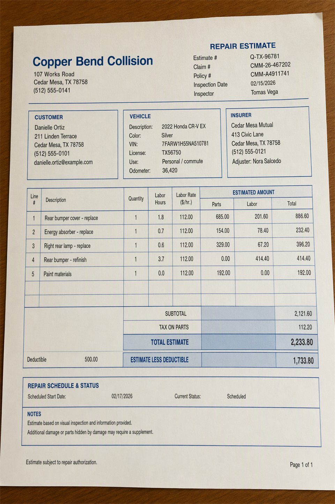

# Data

<!-- IGNITE TEMPLATE PLACEHOLDER: remove this folder when the session needs no data files. -->

Synthetic auto-insurance claim data for this lab, provided as ten complete
claim packets and individual PDFs. All names and claim details are fictional.

## Documents included

- [Roadside membership cards (demo IDs)](documents/packet-01/01-card.pdf)
- [Policy declarations and endorsements](documents/packet-01/02-policy.pdf)
- [Claim forms and assessments](documents/packet-01/03-claim_form.pdf)
- [Police and incident reports](documents/packet-01/04-incident_report.pdf)
- [Repair estimates](documents/packet-01/05-estimate.pdf)
- [Handwritten statements](documents/packet-01/06-handwriting.pdf)
- [Towing invoices](documents/packet-03/07-invoice.pdf),
  [rental invoices](documents/packet-01/07-invoice.pdf), and
  [supporting quotes](documents/packet-08/07-invoice.pdf)
- [Vehicle inspection reports](documents/packet-01/08-inspection.pdf)
- [Supplemental Form 1099-A documents](documents/packet-01/09-form-1099-a.pdf)

## Example repair estimate

Select the image to open the sample PDF.

## Rental review policy corpus

Synthetic rental-review SOPs for ten states and a shared evidence standard
are in the [v2 corpus](policies/rental/ocr-comparison-v2/manifest.json), with
editable DOCX exports and PDF ingestion copies. See the
[scenario guide](../docs/rental-ocr-comparison.md) and
[recommended agent question](../docs/rental-review-agent-question-v2.md).
Keep claim packets and expected evaluation outcomes separate from policy knowledge.

The corpus includes eleven mixed digital/scanned PDFs, editable DOCX exports
and pre-scan PDF controls. The Python generator creates these assets from its
rule definitions; the DOCX exports are not inputs to PDF generation. The controls
and DOCX exports are used by generation validation and extraction comparisons.
Index only the manifest-listed ingestion PDFs, not evaluation fixtures or controls.
The retired v1 corpus and its ZIP archive have been removed.
